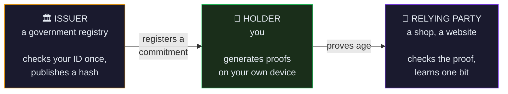
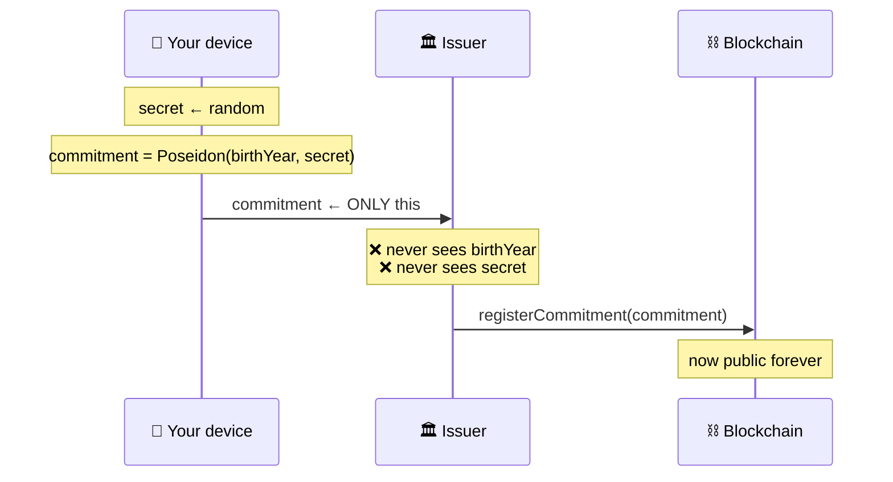
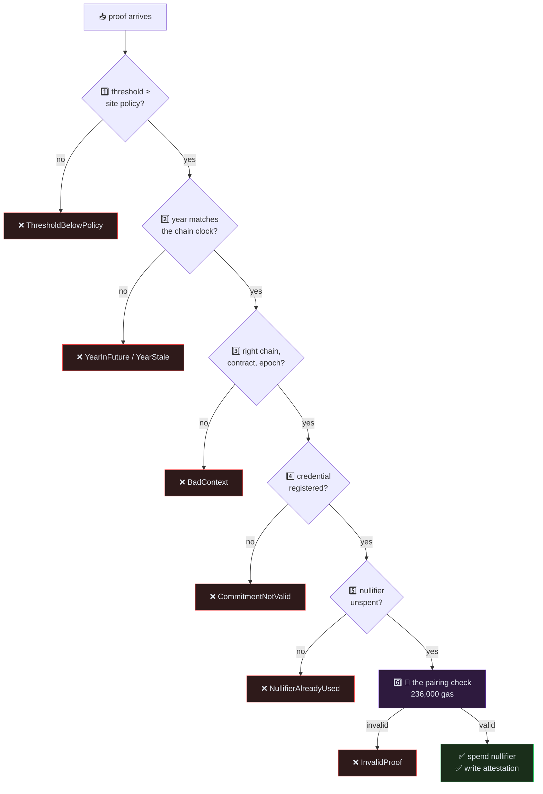

<div align="center">

# 🛡️ Veritas-zk — Developer Walkthrough

### *Understand the whole system, even if you've never touched cryptography*


</div>

---

> [!TIP]
> **Just want to run it?** Double-click **`run.bat`**. It checks your tools,
> installs everything, builds the circuit, starts a blockchain and opens the app.
> Come back here when you want to know *why* it works.

---

## 📖 Table of contents

| # | Section | What you'll get |
|---|---|---|
| 1 | [The problem](#1-the-problem-were-solving) | Why this project exists |
| 2 | [Zero-knowledge in 5 minutes](#2-zero-knowledge-proofs-in-five-minutes) | The core idea, no maths |
| 3 | [The cast](#3-the-cast-of-characters) | Three actors, four contracts |
| 4 | [The full journey](#4-the-full-journey) | Follow one verification end to end |
| 5 | [The circuit](#5-the-circuit-line-by-line) | Every constraint explained |
| 6 | [The contracts](#6-the-smart-contracts) | What runs on-chain |
| 7 | [The frontend](#7-the-frontend) | How the browser proves |
| 8 | [Attacks](#8-four-attacks-and-how-each-one-dies) | The security argument |
| 9 | [Code map](#9-where-everything-lives) | Where to look for what |
| 10 | [Try it](#10-try-it-yourself) | Hands-on exercises |
| 11 | [Glossary](#11-glossary) | Every term, plainly |
| 12 | [Troubleshooting](#12-when-things-go-wrong) | Fixes for common errors |

---

## 1. The problem we're solving

You want to buy something age-restricted online. The site asks you to prove
you're 18.

### 😰 How it works today

```
        YOU                                    THE WEBSITE
   ┌───────────┐                          ┌──────────────────┐
   │  passport │  ──── upload photo ───▶  │  full name       │
   │  photo    │                          │  date of birth   │
   └───────────┘                          │  document number │
                                          │  your face       │
                                          │  address         │
                                          └──────────────────┘
                                          stored… for how long?
                                          breached… when?
```

You handed over your **entire identity** to answer a **single yes/no question**.

And that data now sits in a database you don't control, protected by security
practices you can't inspect, until it leaks.

### 😌 How Veritas works

```
        YOU                                    THE WEBSITE
   ┌───────────┐                          ┌──────────────────┐
   │ birth year│  ─── mathematical ────▶  │  "age ≥ 18"      │
   │  secret   │       proof              │        = true    │
   └───────────┘                          └──────────────────┘
    never leaves                           that's it.
    your device                            that's everything.
```

The website learns **one bit of information**: yes or no. Not your birth year.
Not your name. Not even *which* person you are.

> [!NOTE]
> **The key insight:** proving *"I know a secret with property X"* is a
> completely different thing from *"here is my secret, check property X
> yourself."* Zero-knowledge proofs let you do the first one.

---

## 2. Zero-knowledge proofs in five minutes

### 🎨 The colour-blind friend

Imagine your friend is colour-blind. You have two balls — one red, one green,
identical in every other way. Your friend doesn't believe they're different
colours.

**How do you prove it without telling them which is which?**

```
1. Your friend hides both balls behind their back.
2. They either swap them, or don't — their choice, you can't see.
3. They show you the balls again and ask: "did I swap them?"
4. You answer correctly.
```

Do it once: you had a 50% chance of guessing. Do it **twenty times** and get it
right every time? The odds of guessing are 1 in 1,048,576.

Your friend is now convinced the balls are different colours — and still has
**no idea which one is red**.

That's a zero-knowledge proof. Convincing, and revealing nothing.

### 🔢 From balls to birth years

Real ZK proofs work on maths instead of balls. The statement we prove is:

> *"I know two numbers — `birthYear` and `secret` — such that hashing them
> together gives a value the government already published, AND
> `2026 − birthYear ≥ 18`."*

The proof is about 800 bytes. Anyone can check it in milliseconds. And it
reveals **nothing** about `birthYear` or `secret`.

### 🏭 The three ingredients

<table>
<tr><td width="33%" valign="top">

#### 🔧 The circuit

A program written in **circom** that describes *what* you're proving.

Not really a program — more a **list of equations** that must all be true at
once.

`circuits/attribute_check.circom`

</td><td width="33%" valign="top">

#### 🔑 The keys

A **proving key** (0.64 MB) lets you make proofs.

A **verification key** lets anyone check them.

Both generated once from the circuit by a *trusted setup*.

</td><td width="33%" valign="top">

#### ✅ The verifier

A **Solidity contract**, auto-generated, that checks proofs on Ethereum.

You never write it by hand — `snarkjs` produces it.

`contracts/Groth16Verifier.sol`

</td></tr>
</table>

> [!IMPORTANT]
> **The single most important idea in this whole document:**
>
> A ZK proof proves that a computation ran correctly **on inputs the prover
> chose**. It says *nothing* about whether those were the *right* inputs.
>
> If the prover gets to pick "the minimum age is 0", the proof will be
> perfectly valid — and completely useless. **Something else must check the
> inputs.** In Veritas, that something is the smart contract. Section 8 shows
> what happens when you forget this.

---

## 3. The cast of characters

### 👥 Three actors



In the demo app all three are tabs in one browser, but they represent three
genuinely separate parties who don't trust each other.

### 📜 Four contracts

| Contract | Job | Think of it as… |
|---|---|---|
| 🔐 **`Groth16Verifier.sol`** | Checks the maths of a proof | A calculator. Auto-generated, never edited. |
| 📋 **`CredentialRegistry.sol`** | The public list of issued credentials | A phone book of hashes. |
| ⚙️ **`VeritasCore.sol`** | The brain — policy, rules, records | The bouncer who checks everything. |
| 🚪 **`GatedContent.sol`** | An example age-restricted resource | The door the bouncer guards. |

> [!TIP]
> **Read `VeritasCore.sol` first.** It's where every design decision lives, and
> every non-obvious line has a comment saying *why*.

---

## 4. The full journey

Let's follow one verification from start to finish. Four acts.

### 🎬 Act 1 — Getting a credential

You visit the government office once. They check your real passport, the
old-fashioned way.

Then, **on your own device**:

```js
// 1. Your device rolls a gigantic random number.
//    ~254 bits of entropy — unguessable.
secret = randomSecret()          // e.g. 8837291043...

// 2. Hash it together with your birth year.
commitment = Poseidon(2000, secret)
//         = 11664204686705353987996298182432074745...
```

You send the issuer **only the commitment**. They publish it on the blockchain.



> [!WARNING]
> **Why the issuer must never learn your secret**
>
> This is not a nitpick — it's the difference between a private system and a
> surveillance system.
>
> Your nullifier (see below) is derived from your secret. An issuer who knew
> your secret could compute **every nullifier you will ever produce**, and so
> recognise you at every website you ever verify at. They could also
> impersonate you outright.
>
> The commitment is a one-way hash salted with 254 bits of randomness. Even
> knowing you were born in one of ~100 plausible years, guessing it is
> impossible.

You save a small JSON file. **That file is your credential.**

```json
{
  "schema": "veritas.credential/v1",
  "birthYear": 2000,
  "secret": "8837291043...",
  "commitment": "1166420468...",
  "warning": "This file contains your private secret..."
}
```

### 🎬 Act 2 — Making a proof

Months later, you're on a website that needs proof of age.

Your browser asks the contract for the current rules:

```js
const [context, epoch, year, minAge] = await core.proverParams();
// context = 0x0025338a...   ← identifies this site, this chain, this month
// year    = 2026            ← the contract's own clock
// minAge  = 18              ← this site's policy
```

Then it builds a proof — **in a Web Worker**, so the page doesn't freeze:

```js
const proof = await snarkjs.groth16.fullProve({
  birthYear: 2000,      // 🔒 PRIVATE — never sent anywhere
  secret:    "8837...", // 🔒 PRIVATE — never sent anywhere
  context:   "0x0025338a...",
  packed:    pack(yourAddress, 2026, 18),
}, wasmFile, provingKey);
```

⏱️ **Takes about half a second.**

Out comes a proof and exactly **four public values**:

| # | Signal | Example | What it reveals |
|:-:|---|---|---|
| 0 | `commitment` | `1166420468…` | Which registered credential — but *not* whose |
| 1 | `nullifier` | `3155646946…` | A one-time token for this site+month |
| 2 | `context` | `0025338a…` | Which site, chain and time period |
| 3 | `packed` | `2760931934…` | Your address, the year, the threshold |

> [!NOTE]
> **Look at what's missing.** No birth year. No secret. Those two numbers went
> into the maths and **never came out**. Open your browser's Network tab during
> the demo and search every request for "2000" — it isn't there. Not
> encrypted — *never sent*.

### 🎬 Act 3 — Verification

Your browser sends the proof to `VeritasCore.verifyAge()`. The contract runs
**seven checks, cheapest first**:



> [!TIP]
> **Why cheapest-first?** The pairing check costs 236,000 gas — 79% of the
> whole transaction. Running the trivial comparisons first means a bad
> submission fails for a few thousand gas instead. Ordering checks by cost is
> free performance.

If everything passes, the contract writes an **attestation**:

```solidity
attestations[you] = {
    validUntil: <end of this month>,
    minAge:     18,
    epoch:      689
};
```

### 🎬 Act 4 — Using it

Any website can now ask one question:

```solidity
if (!attestor.isVerifiedAtLeast(msg.sender, 18)) revert NotAgeVerified();
```

That's the entire integration. One line. The website never sees a proof, a
commitment, or a birth year.

> [!IMPORTANT]
> **The gate is real.** In many demos the "restricted page" is just hidden by a
> JavaScript variable — open DevTools, flip it to `true`, and you're in.
>
> Here the check is a `require` **inside the EVM**. There's nothing on your
> screen to flip. Refresh the page, open a different browser, use a different
> computer — the answer comes from the blockchain every time.

---

## 5. The circuit, line by line

📄 `circuits/attribute_check.circom` — **761 constraints**

A circuit isn't code that "runs". It's a **list of equations that must all be
true simultaneously**. If you can supply numbers satisfying every equation, you
can make a proof. If you can't, you can't — there's no way to fake it.

### Inputs

```circom
signal input birthYear;   // 🔒 private
signal input secret;      // 🔒 private
signal input context;     // 🌍 public
signal input packed;      // 🌍 public
signal output commitment; // 🌍 public — computed, not supplied
signal output nullifier;  // 🌍 public — computed, not supplied
```

> [!NOTE]
> `commitment` and `nullifier` are **outputs**, not inputs. The circuit computes
> them. That kills a whole class of bug: there's no "claimed" commitment that
> could disagree with the real one, because you never get to claim anything.

### Constraint 1 — Unpack and range-check

```circom
component packedBits = Num2Bits(192);
packedBits.in <== packed;
```

One line doing **three jobs**:

1. ✅ Proves `packed` fits in 192 bits, so Solidity's casts can't truncate
2. ✅ Range-checks `currentYear` and `threshold` to 16 bits each
3. ✅ **Binds** the address into the proof

> [!WARNING]
> **Job 3 is subtle and critical.** In Groth16, a public input that appears in
> *no constraint* has a zero coefficient — verification becomes completely
> independent of its value. You'd think you'd bound the address into the proof,
> and you'd have bound nothing at all. `Num2Bits` forces it into real equations.

### Constraint 2 — Range-check the birth year

```circom
component birthYearBits = Num2Bits(16);
birthYearBits.in <== birthYear;
```

This tiny line closes **the most serious bug the original design had**.

<details>
<summary><b>🐛 Click: the attack this prevents</b></summary>

Circuit values aren't ordinary integers. They're elements of a **finite field** —
numbers that wrap around at a huge prime `p`:

```
p = 21888242871839275222246405745257275088548364400416034343698204186575808495617
```

Arithmetic wraps, like a clock. So an attacker could set:

```
birthYear = p − 100
```

Then:

```
age = currentYear − birthYear
    = 2026 − (p − 100)
    = 2126   (mod p)
```

A "birth year" of roughly 2×10⁷⁶ produces an **age of 2126**, which sails past
any threshold. The comparison logic was perfectly correct — it was fed a value
that was never a real year.

`Num2Bits(16)` makes it impossible: there's simply no way to write `p − 100` as
16 bits, so no valid witness exists.

**Worth knowing:** the earlier project notes blamed an *"8-bit comparator
overflow when age ≥ 256"*. That diagnosis was wrong — the comparator rejects
274 correctly. Widening it would have fixed nothing. The real hole was the
unconstrained input.

</details>

### Constraints 3 & 4 — The actual age check

```circom
signal age;
age <== currentYear - birthYear;

component ageBits = Num2Bits(16);   // no negative ages: p−k won't fit in 16 bits
ageBits.in <== age;

component isOldEnough = GreaterEqThan(16);
isOldEnough.in[0] <== age;
isOldEnough.in[1] <== threshold;
isOldEnough.out === 1;              // ← must be true, or no proof exists
```

That final `=== 1` is the whole point. If you're 17, there is **no** set of
numbers that satisfies it. Proof generation doesn't produce a "false" proof —
it fails outright.

### Constraint 5 — Commitment binding

```circom
component commitmentHasher = Poseidon(2);
commitmentHasher.inputs[0] <== birthYear;
commitmentHasher.inputs[1] <== secret;
commitment <== commitmentHasher.out;
```

Ties the proof to a credential a real issuer actually issued. Without this, the
age check proves nothing about a *real person* — you'd just invent a convenient
birth year.

### Constraint 6 — The nullifier

```circom
component nullifierHasher = Poseidon(2);
nullifierHasher.inputs[0] <== secret;
nullifierHasher.inputs[1] <== context;
nullifier <== nullifierHasher.out;
```

<table>
<tr><th width="50%">❌ The obvious design</th><th width="50%">✅ What we do</th></tr>
<tr><td>

`Poseidon(secret, secret)`

Same value every time, everywhere.

- 💀 Credential burns out after **one** use, forever
- 💀 A permanent tracking ID across every website

</td><td>

`Poseidon(secret, context)`

Changes per site and per month.

- ✅ Single-use *per site, per month*
- ✅ Two sites **cannot** link your visits
- ✅ Credential stays usable for years

</td></tr>
</table>

> [!TIP]
> **Why Poseidon and not SHA-256?** Poseidon is designed for ZK circuits: ~243
> constraints per hash. SHA-256 needs **tens of thousands**. Using SHA-256 here,
> proving would take minutes instead of half a second and the setup files would
> be enormous.

---

## 6. The smart contracts

### 🧠 `VeritasCore.sol` — the brain

The heart of it, with the noise stripped out:

```solidity
function verifyAge(uint[2] a, uint[2][2] b, uint[2] c, uint[4] pub)
    external returns (address subject, uint64 validUntil)
{
    // Unpack: subject ‖ year ‖ threshold, all from one field element
    uint256 packed = pub[PUB_PACKED];
    if (packed >> 192 != 0) revert MalformedPublicInput();
    subject = address(uint160(packed >> 32));

    Policy memory p = policy;                    // ← one storage read

    // Pin every prover-chosen value to state the prover cannot control
    if (uint16(packed) < p.minAge)          revert ThresholdBelowPolicy(...);
    if (provenYear > chainYear)             revert YearInFuture(...);
    if (pub[PUB_CONTEXT] != contextFor(e))  revert BadContext(...);
    if (!registry.isValid(commitment))      revert CommitmentNotValid(...);
    if (nullifierUsed[nullifier])           revert NullifierAlreadyUsed(...);

    // Only now, the expensive part
    if (!verifier.verifyProof(a, b, c, pub)) revert InvalidProof();

    nullifierUsed[nullifier] = true;
    _attestations[subject] = Attestation({ validUntil: ..., minAge: ... });
    emit AgeVerified(subject, msg.sender, ...);
}
```

> [!IMPORTANT]
> **Look at line 3 from the bottom: `_attestations[subject]`, not
> `_attestations[msg.sender]`.**
>
> The attestation goes to whoever the **proof names**, never to whoever sent
> the transaction. This one choice does two things at once:
>
> - 🛡️ A stolen proof is worthless — a thief can only pay gas to deliver the
>   victim their own attestation
> - 🎁 Someone else can pay your gas fees, without you handing them anything

### 📋 `CredentialRegistry.sol` — the phone book

```solidity
mapping(uint256 commitment => Credential) private _credentials;

struct Credential {
    uint64 issuedAt;    // 0 = never registered
    uint64 expiresAt;   // 0 = never expires
    bool   revoked;
}
```

> [!NOTE]
> **64 + 64 + 8 = 136 bits — that fits in one storage slot.** So `isValid()` is
> a single read instead of three. `VeritasCore` calls it on every verification,
> and the whole transaction has a 300,000 gas budget. Struct layout is a
> performance decision, not a cosmetic one.

Only an account holding `ISSUER_ROLE` can register. Otherwise anyone could
self-issue a credential claiming any birth year, and the entire trust model
collapses.

### 🚪 `GatedContent.sol` — proof the gate is real

```solidity
modifier onlyAgeVerified() {
    if (!attestor.isVerifiedAtLeast(msg.sender, requiredAge)) {
        revert NotAgeVerified(msg.sender, requiredAge);
    }
    _;
}
```

About 60 lines, most of them comments. It never sees a proof, a commitment, or
a birth year — it asks one question and gets one boolean. That is how easy
integrating with Veritas should be.

---

## 7. The frontend

### 🗺️ The six pages

| Page | Who you're being | What it shows |
|---|---|---|
| 🏠 **Home** | — | The pitch, connect your wallet |
| 🏛️ **Issuer** | Government | Issue a credential, download the file |
| 🧑 **Prove** | Citizen | Load → prove → verify, in three steps |
| 🔒 **Restricted** | Customer | The gated content, unlocked from-chain |
| 🔍 **Explorer** | Public | Everything on-chain — look for a birth date |
| 📖 **How it works** | Student | The explainer. Needs no wallet at all. |

### ⚙️ Proving without freezing the browser

Generating a proof is half a second of solid CPU work. On the main thread that
**freezes the entire tab** — no spinner animation, no cancel button, no
scrolling.

So it runs in a **Web Worker**, a genuine background thread:

```
Main thread                     Worker thread
───────────                     ─────────────
 UI stays smooth  ──postMessage──▶  fetch .wasm + .zkey
 progress bar     ◀──progress────   compute witness
 cancel button    ◀──progress────   generate proof
 shows result     ◀────done─────    verify locally (free)
```

<details>
<summary><b>🔧 Click: why the worker loads snarkjs so oddly</b></summary>

Look at `frontend/public/prover.worker.js`:

```js
importScripts('/zk/snarkjs.min.js');   // ← not `import`
```

That looks primitive. It's deliberate.

`snarkjs` is published Node-first. Its dependencies reach for `process`,
`Buffer` and `os.cpus()` — none of which exist in a browser. Pushing it through
Vite means polyfilling all of that and fighting the bundler into picking the
browser build. It's fragile and breaks on minor version bumps.

`importScripts` loads the pre-built bundle directly, skipping the bundler
entirely. Less fashionable. Far more robust.

**Related win:** we also swapped `circomlibjs` for `poseidon-lite` in the app
bundle. Same hash, zero Node dependencies, and the bundle dropped from **2.93 MB
to 683 KB**. `tests/parity.test.js` pins the two implementations against each
other *and* against the circuit, so they can never silently drift apart.

</details>

### 🚨 Turning reverts into English

Raw blockchain errors are hostile:

```
Error: execution reverted (unknown custom error) data="0x8baa579f"
```

`frontend/src/contracts/errors.js` decodes them into something useful:

```
❌ This proof has already been used
   Replay protection rejected the transaction. Each proof is valid
   exactly once per verification period.
   💡 This is the system working as designed, not a fault.
```

<details>
<summary><b>🔧 Click: why decoding this is harder than it looks</b></summary>

Four traps:

1. **ethers v6 only auto-decodes errors declared in the ABI you called.** A
   revert thrown *inside* `CredentialRegistry` while `VeritasCore` is running
   arrives as raw bytes. You must retry against every ABI you know.
2. **The revert bytes hide at different depths** — `err.data`,
   `err.info.error.data`, `err.error.data`… depending on the wallet.
3. **Empty revert data (`0x`) almost never means "reverted without a reason."**
   It usually means *there is no contract at that address*, or you're on the
   wrong network. Reporting it as a revert sends you hunting for hours.
4. `Panic(uint256)` and legacy `Error(string)` need separate handling.

</details>

### ⏱️ Simulate before you sign

Before opening your wallet, the app calls `staticVerify()` — a dry run that
costs nothing:

```js
const [ok, reason] = await core.staticVerify(a, b, c, pub);
if (!ok) { /* show the exact reason, never open the wallet */ }
```

No wasted gas, no scary "this transaction will likely fail" banner, and a
precise explanation instead of a guess.

---

## 8. Four attacks, and how each one dies

> [!TIP]
> Run `run.bat demo` to watch all four fail live, in colour.

### 🗡️ Attack 1 — Replay

> *"I'll grab the transaction data from the blockchain and submit it again."*

```
✓ blocked — NullifierAlreadyUsed
```

Each proof carries a nullifier. The contract records spent ones. Try it twice,
get rejected.

### 🗡️ Attack 2 — Proof theft

> *"I'll watch the mempool, copy someone's proof before it's mined, change the
> address to mine, and submit it first."*

```
✓ blocked — InvalidProof
```

The address is baked **into the proof's mathematics**. Change one bit and the
pairing check fails. And submitting it *unchanged* achieves nothing — the
attestation goes to the rightful owner, and the thief just paid for their gas.

### 🗡️ Attack 3 — Threshold forgery

> *"The threshold is just an input I supply. I'll say the minimum age is 0."*

```
✓ blocked — ThresholdBelowPolicy
```

The proof is genuinely valid — it correctly proves "my age ≥ 0". The contract
rejects it because *its own policy* says 18.

> [!WARNING]
> **This one was exploitable in the original project specification.** It's the
> clearest example of the rule from Section 2: a valid proof of the wrong
> statement is worthless. Only the chain knows the real policy, so only the
> chain can enforce it.

### 🗡️ Attack 4 — Year forgery

> *"I was born in 2020. But if I claim the current year is 2046, I'm 26."*

```
✓ blocked — YearInFuture
```

The contract derives the year from `block.timestamp` and refuses anything in
the future. A year in the *past* is harmless — it only makes you look younger —
so a small lag is tolerated to avoid a race on New Year's Eve.

### 📊 The scoreboard

| Attack | Stopped by | Test |
|---|---|---|
| Replay | Nullifier set | `rejects the same proof submitted twice` |
| Proof theft | Address bound in-circuit | `cannot be redirected by editing the subject` |
| Threshold forgery | On-chain policy | `rejects a proof that claims a threshold below policy` |
| Year forgery | Chain clock | `rejects a proof built for a year in the future` |
| Field wraparound | `Num2Bits` | `rejects a birth year supplied as a large field element` |
| Self-issuance | `ISSUER_ROLE` | `rejects registration from a non-issuer` |
| Cross-chain replay | Context binding | `rejects a proof built for a different chain` |
| Gate bypass | On-chain read | `blocks a caller who has not verified` |

**85 tests. Every finding has a named regression test.**

---

## 9. Where everything lives

```
veritas/
│
├── 🚀 run.bat                       ← START HERE
├── 📖 WALKTHROUGH.md                ← you are here
├── 📄 README.md
│
├── 🔧 circuits/
│   └── attribute_check.circom       the 761-constraint circuit
│
├── 📜 contracts/
│   ├── VeritasCore.sol              ⭐ read this first
│   ├── CredentialRegistry.sol
│   ├── Groth16Verifier.sol          auto-generated, never edit
│   └── examples/GatedContent.sol
│
├── ⚙️ scripts/
│   ├── zk/build.mjs                 the whole circuit pipeline
│   ├── deploy.js
│   └── demo.js                      ⭐ the narrated end-to-end run
│
├── 🧪 tests/                        85 tests
│   ├── circuit.test.js              soundness
│   ├── VeritasCore.test.js          ⭐ every attack, as a test
│   ├── Gas.test.js                  the < 300k budget, enforced
│   └── parity.test.js               3 Poseidons must agree
│
├── 🎨 frontend/src/
│   ├── zk/                          browser proving
│   ├── contracts/errors.js          ⭐ revert → English
│   ├── providers/                   wallet, credential, session
│   └── pages/                       the six screens
│
└── 📚 docs/
    ├── architecture.md              diagrams
    ├── threat-model.md              ⭐ the security argument
    └── gas-report.md                every optimisation, measured
```

### 🎯 Suggested reading order

```
1️⃣  docs/architecture.md          get the shape
2️⃣  circuits/attribute_check.circom   what's being proved
3️⃣  contracts/VeritasCore.sol     what's enforced
4️⃣  scripts/demo.js               watch it work
5️⃣  tests/VeritasCore.test.js     watch attacks fail
6️⃣  frontend/src/pages/ProvePage.jsx   the user's view
```

---

## 10. Try it yourself

### 🥉 Beginner

<details>
<summary><b>Exercise 1 — Prove the birth year never leaves your browser</b></summary>

1. Run `run.bat` and open the app
2. Open DevTools → **Network** tab
3. Go through the whole Prove flow
4. Search every request for your birth year, e.g. `2000`

**You will not find it.** Not encrypted — never sent.

</details>

<details>
<summary><b>Exercise 2 — Watch replay protection work</b></summary>

Complete a verification, then click **"Attempt a replay attack"** on the
Restricted page.

That's the exact same proof that just succeeded, resubmitted. Rejected.

</details>

<details>
<summary><b>Exercise 3 — Prove the gate is on-chain</b></summary>

After verifying, **hard-refresh** the Restricted page. Still unlocked.

Now open it in a **different browser** with the same account imported. Still
unlocked — because the answer lives on the blockchain, not in the tab.

</details>

### 🥈 Intermediate

<details>
<summary><b>Exercise 4 — Try to be 17</b></summary>

Issue a credential with birth year `2015`, then try to prove.

Proof generation **fails**. It doesn't produce a "false" proof — the constraints
have no solution, so no proof exists at all.

</details>

<details>
<summary><b>Exercise 5 — Break it on purpose 🔥</b></summary>

Let's reintroduce the field-wraparound bug and watch a test catch it.

**First attempt.** Open `circuits/attribute_check.circom` and comment out just
the birth-year range check:

```circom
// component birthYearBits = Num2Bits(16);
// birthYearBits.in <== birthYear;
```

Rebuild and test:

```bash
npm run zk:build
npx hardhat test tests/circuit.test.js
```

**Result: still 20 passing.** The attack is still blocked!

> 🤔 **Why?** Because `age` is *also* range-checked, and *also* capped at 130.
> With `birthYear = p − 100` the age comes out as 2126, which fails
> `ageCeiling`. You removed one lock and three others were still holding the
> door.

**Second attempt.** Now comment out all four guards — `birthYearBits`,
`birthYearFloor`, `ageBits` and `ageCeiling` — then rebuild and test again.

**Result: 3 failing**, including:

```
rejects a birth year supplied as a large field element (the p−k attack)
   AssertionError: expected true to equal false
```

`expected true to equal false` means witness generation **succeeded** when it
should have been impossible. The circuit is now unsound: an attacker can be any
age they like.

Restore the file with `git checkout circuits/attribute_check.circom`, rebuild,
and watch all 85 tests go green again.

> [!TIP]
> **The real lesson isn't "this line is important."** It's **defence in
> depth**: four independent constraints each block the same attack, so no
> single mistake is fatal. That is how safety-critical code should be written —
> and it's why the first attempt surprised you.

</details>

### 🥇 Advanced

<details>
<summary><b>Exercise 6 — Change the policy</b></summary>

In `scripts/deploy.js`, change `minAge: 18` to `minAge: 21`. Redeploy.

Now an existing 18+ proof is rejected with `ThresholdBelowPolicy` — the
credential didn't change, the *policy* did.

</details>

<details>
<summary><b>Exercise 7 — Add a new attribute</b></summary>

Extend the circuit to also prove country of residence:

1. Add `signal input country` and a constraint
2. Include it in the commitment: `Poseidon(birthYear, country, secret)`
3. Rebuild — `npm run zk:build`
4. Watch the constraint count and gas cost change
5. Update `VeritasCore` for the new public-signal layout

This teaches you the most important practical lesson: **the public-signal order
is a contract between the circuit, Solidity and the frontend.** Change one, and
you must change all three. `circuits/public_signals.json` records the real order
so the tests can catch you.

</details>

---

## 11. Glossary

| Term | In plain English |
|---|---|
| **Zero-knowledge proof** | Proof that a statement is true, revealing nothing else |
| **zk-SNARK** | A ZK proof that's tiny and fast to check |
| **Groth16** | The specific SNARK we use — smallest proofs, cheapest verification |
| **Circuit** | A list of equations describing what you're proving |
| **Constraint** | One equation. Ours has 761. |
| **Witness** | The actual numbers satisfying every equation. Secret. |
| **Public signal** | A value the verifier sees. We have 4. |
| **Private input** | A value only you see. `birthYear` and `secret`. |
| **Commitment** | A one-way hash of your data. Public, but reveals nothing. |
| **Nullifier** | A one-time token proving "used once" without saying by whom |
| **Poseidon** | A hash function designed to be cheap inside circuits |
| **Finite field** | Numbers that wrap around at a huge prime. Source of subtle bugs. |
| **Trusted setup** | A one-off ceremony producing the keys |
| **Toxic waste** | Randomness from the setup that must be destroyed |
| **Powers of Tau** | The reusable first half of a trusted setup |
| **Attestation** | The on-chain record saying "this address proved 18+" |
| **Epoch** | A time window. Ours is 30 days. |
| **Context** | An identifier for chain + contract + epoch |
| **Gas** | The cost of running something on Ethereum |
| **Revert** | A transaction aborting and undoing everything |
| **ABI** | The description of a contract's functions |

---

## 12. When things go wrong

<details>
<summary><b>❌ "circom is not recognized"</b></summary>

circom 2 is a standalone `.exe` with no installer.

**Let `run.bat` do it** — it offers to download it automatically.

> ⚠️ **Do not run `npm install -g circom`.** That installs version **0.5.46**,
> the old pre-2.0 compiler, which cannot build this circuit. If you already did:
> `npm uninstall -g circom`

</details>

<details>
<summary><b>❌ Circuit tests are skipping</b></summary>

```
⚠  Circuit artifacts not found in build/.
   Run:  npm run zk:build
```

Exactly what it says. The tests skip loudly rather than failing confusingly.

</details>

<details>
<summary><b>❌ "Call failed with no reason"</b></summary>

Almost always one of:

- MetaMask is on the wrong network → switch to **Localhost 8545, chain 31337**
- The blockchain was restarted, so the addresses in `frontend/.env.local` are
  stale → re-run `npm run deploy:local`

</details>

<details>
<summary><b>❌ "Credential not registered"</b></summary>

The commitment isn't in the registry. Either:

- You entered a different birth year or secret than when it was issued
- The chain was restarted and the registry is empty again
- You're connected to a different network

Re-issue from the Issuer tab.

</details>

<details>
<summary><b>❌ MetaMask says "nonce too high"</b></summary>

Classic local-chain issue — you restarted the node but MetaMask remembers the
old transaction count.

**MetaMask → Settings → Advanced → Clear activity tab data**

</details>

<details>
<summary><b>❌ The tests hang forever after printing results</b></summary>

Already fixed, but worth understanding: `snarkjs` starts a background worker
pool and caches it on `globalThis.curve_bn128`. Mocha finishes, but the process
never exits.

`tests/setup.js` shuts it down. If you write a new script that calls `snarkjs`
directly, you need the same teardown.

</details>

<details>
<summary><b>❌ Port 8545 is already in use</b></summary>

An old blockchain is still running. Either let `run.bat` reuse it — it detects
this — or close the old window.

</details>

---

<div align="center">

## 🎓 You now understand the whole system

**Circuit** → what's proved · **Contract** → what's enforced · **Browser** → where secrets stay

<br/>

| Next step | Where |
|---|---|
| 🏃 Run it | `run.bat` |
| 🎬 Watch the attacks fail | `run.bat demo` |
| 🧪 Run the tests | `run.bat test` |
| 🛡️ The security argument | [`docs/threat-model.md`](docs/threat-model.md) |
| 📐 The diagrams | [`docs/architecture.md`](docs/architecture.md) |
| ⛽ Every optimisation | [`docs/gas-report.md`](docs/gas-report.md) |

<br/>

> *"Prove you are old enough — without revealing when you were born."*

</div>
