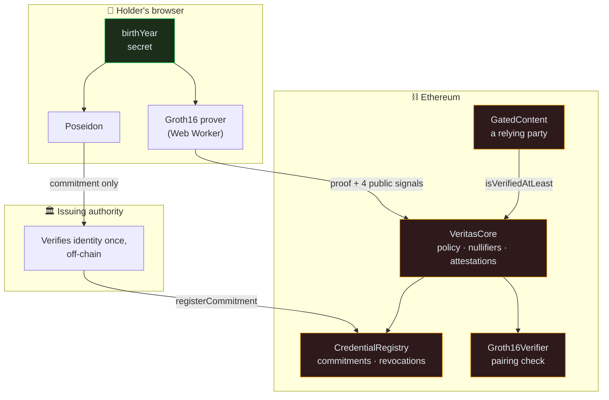
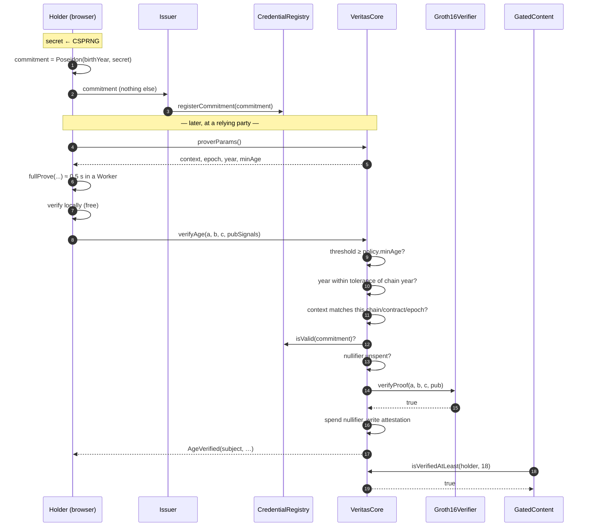
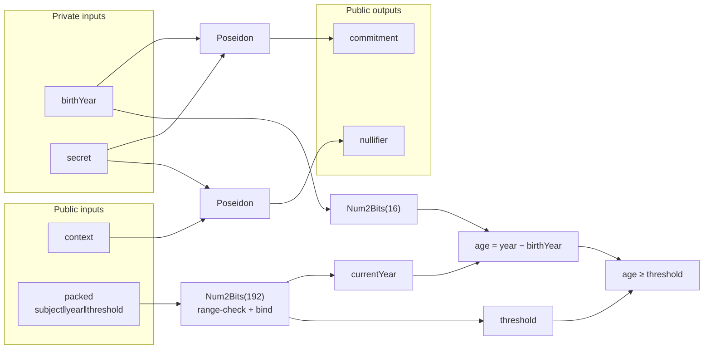
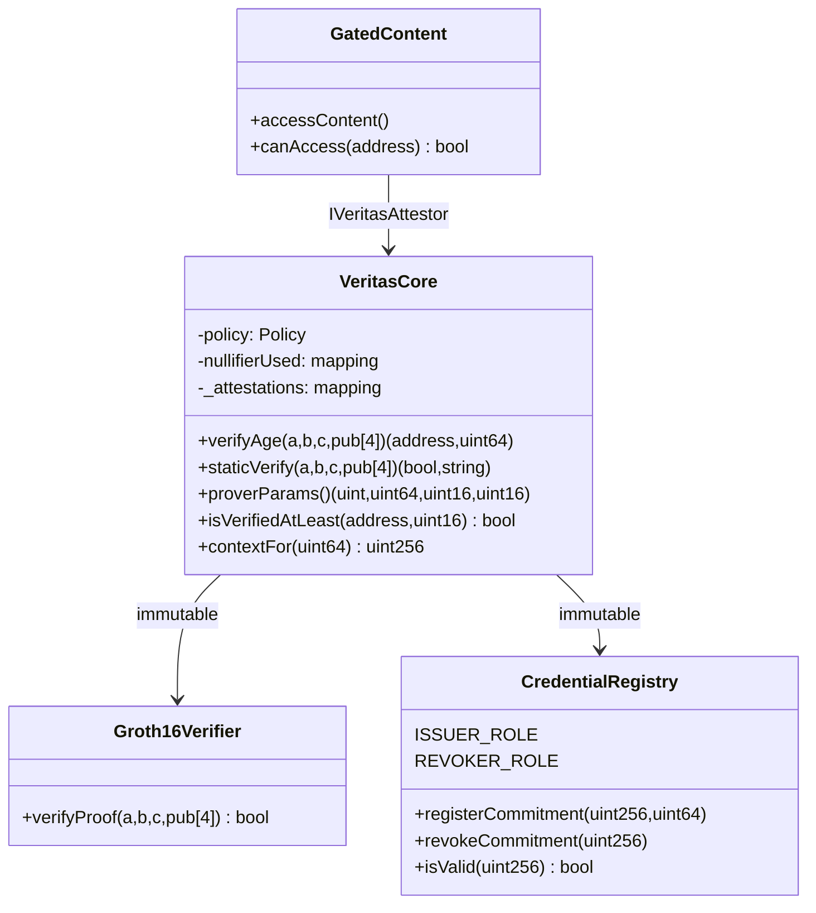

# Veritas-zk — Architecture

## 1. System overview

Three actors, and one fact travelling between them without the data behind it.

The green box never leaves the device. Everything crossing a boundary is a hash,
a proof, or a boolean.

## 2. A verification, step by step

Note the ordering in the contract: the cheap policy checks run **before** the
expensive pairing, so a malformed submission fails for a few thousand gas rather
than 236,000.

## 3. Inside the circuit

761 non-linear constraints, of which about 486 are the two Poseidon
permutations. The full breakdown is in [gas-report.md](gas-report.md).

## 4. Contracts

`VeritasCore` holds both dependencies as `immutable`, so the hot path reaches
them without a storage read — worth 4,200 gas against a 300,000 budget.

Note also what is **not** here: the nullifier set lives in `VeritasCore`, not in
the registry as the original specification proposed. The registry is the
*issuance* authority (issuer-driven, revocable); nullifiers are *consumption*
state (user-driven). Keeping them apart makes "only the core can spend a
nullifier" true by construction rather than by a role grant that could be
misconfigured, and removes a circular deployment dependency.

## 5. The security model in one table

| Value | Where it lives | Who can see it |
|---|---|---|
| `birthYear` | Browser memory only | The holder |
| `secret` | Browser memory only, generated locally | The holder alone — **not the issuer** |
| Witness | Browser memory, discarded | Nobody |
| `commitment` | On-chain, public | Everyone (a salted hash) |
| `nullifier` | On-chain, public | Everyone (reveals only "this credential was used in this context") |
| `context` | On-chain, public | Everyone |
| `threshold`, `currentYear` | On-chain, public | Everyone |
| Attestation | On-chain, public | Everyone (an address and a minimum age) |

The strongest statement the chain permits is: *"the holder of some registered
credential proved they meet a threshold in this context."* It supports no
inference about which credential, whose it is, or what birth year opened it.

## 6. Design decisions

Recorded here because the reasoning matters more than the outcome.

**Every parameter is a public signal.** A SNARK proves a computation ran
correctly on inputs the prover chose; it certifies nothing about whether those
were the *right* inputs. Publishing the threshold, year, context and subject is
what lets the contract check each against state the prover does not control.
Two of the original specification's designs were exploitable precisely here.

**The nullifier is context-scoped.** `Poseidon(secret, secret)` would be
simpler, and would burn a credential permanently on first use while acting as a
stable cross-site tracking identifier. `Poseidon(secret, context)` is single-use
per relying party per epoch, and unlinkable across them.

**The proof names its beneficiary.** A proof in the mempool is a bearer token.
Committing to the subject address inside the circuit makes a stolen proof
worthless, and simultaneously makes relaying safe.

**Three values are packed into one field element.** Groth16 costs roughly 6,000
gas per public signal. Packing `subject‖year‖threshold` saves about 12,300 gas
and is the difference between missing and meeting the project's stated target.

**Groth16 rather than PLONK.** Groth16 has the smallest proofs and cheapest
on-chain verification, at the cost of a circuit-specific trusted setup. For a
fixed circuit that trade is right; PLONK's universal setup would matter if the
circuit changed often.
