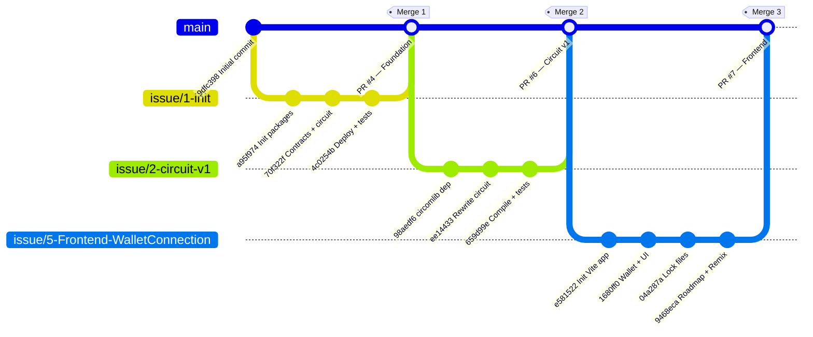

# 🛡️ Veritas-zk — Project Analysis Report

**Date:** August 18, 2026  
**Repository:** [qqAli47/Veritas-zk](https://github.com/qqAli47/Veritas-zk)  
**Branch:** `main` (at commit `a9cc4fe`)  
**Analyzed by:** Full git history review + source code audit

---

## 1. Git History Summary

The project has **14 total commits** across **4 branches**, organized into **3 merge PRs** on `main`:



### Contributors
| Handle | Email | Contributions |
|--------|-------|---------------|
| **alim6t** | thek46802@gmail.com | Issue #1 init (3 commits), Issue #2 circuit (3 commits) |
| **Hasan Zidan (7zrs)** | hasansabetzidan@gmail.com | Issue #5 frontend (4 commits), merge management |
| **qqAli47** | ali.alaliqq47@gmail.com | Merge #4 approval, initial commit |

---

## 2. What Each Merge Delivered

### Merge 1 — PR #4: Foundation (`issue/1-init`) — *May 27, 2026*

| Artifact | Status | Notes |
|----------|--------|-------|
| [hardhat.config.js](file:///c:/Users/LOQ/Documents/veritas/hardhat.config.js) | ✅ Working | Solidity 0.8.20, Sepolia + Hardhat networks |
| [CredentialRegistry.sol](file:///c:/Users/LOQ/Documents/veritas/contracts/CredentialRegistry.sol) | ✅ Complete | `addCommitment()`, `isRegistered()`, duplicate guard |
| [Verifier.sol](file:///c:/Users/LOQ/Documents/veritas/contracts/Verifier.sol) | ⚠️ Placeholder | Always returns `false` — to be replaced by SnarkJS generated verifier |
| [attribute_check.circom](file:///c:/Users/LOQ/Documents/veritas/circuits/attribute_check.circom) | ⚠️ Initial draft | Was later rewritten in Merge 2 |
| [deploy.js](file:///c:/Users/LOQ/Documents/veritas/scripts/deploy.js) | ✅ Working | Deploys both contracts via Ethers v6 |
| [sample-test.js](file:///c:/Users/LOQ/Documents/veritas/tests/sample-test.js) | ✅ Working | 1 test — deploys + registers a commitment |
| Directory structure | ✅ Created | `circuits/`, `contracts/`, `frontend/`, `scripts/`, `tests/`, `docs/` |

---

### Merge 2 — PR #6: Circuit v1 (`issue/2-circuit-v1`) — *Jul 24, 2026*

| Artifact | Status | Notes |
|----------|--------|-------|
| [attribute_check.circom (v1)](file:///c:/Users/LOQ/Documents/veritas/circuits/attribute_check.circom) | ✅ Rewritten | Uses `GreaterEqThan(8)` from circomlib. Range check only (no Poseidon yet) |
| [square.circom](file:///c:/Users/LOQ/Documents/veritas/circuits/square.circom) | ✅ Warm-up | Proves knowledge of square root — toolchain validation |
| [input.json](file:///c:/Users/LOQ/Documents/veritas/circuits/input.json) | ✅ Sample | birthYear: 2000, currentYear: 2024, threshold: 18 |
| [compile_circuit.ps1](file:///c:/Users/LOQ/Documents/veritas/scripts/compile_circuit.ps1) | ✅ Full pipeline | 7-step: compile → PoT → Groth16 setup → contribute → export vkey → witness → verify |
| [generate_proof.js](file:///c:/Users/LOQ/Documents/veritas/scripts/generate_proof.js) | ✅ Working | Programmatic fullProve + verify, exports `generateProof`/`verifyProof` |
| [circuit-test.js](file:///c:/Users/LOQ/Documents/veritas/tests/circuit-test.js) | ✅ 5 tests | 2 positive (adult, boundary), 2 negative (underage, future birth), graceful skip if no build artifacts |
| circomlib dependency | ✅ Added | `circomlib@^2.0.5` in `package.json` |

---

### Merge 3 — PR #7: Frontend & Wallet (`issue/5-Frontend-WalletConnection`) — *Aug 11, 2026*

| Artifact | Status | Notes |
|----------|--------|-------|
| Vite + React app | ✅ Scaffolded | `frontend/` directory with Vite 5, React 18, Ethers 6 |
| [useWallet.js](file:///c:/Users/LOQ/Documents/veritas/frontend/src/hooks/useWallet.js) | ✅ Working | MetaMask connect/disconnect, auto-detect, account/chain change listeners |
| [ConnectWallet.jsx](file:///c:/Users/LOQ/Documents/veritas/frontend/src/components/ConnectWallet.jsx) | ✅ Working | MetaMask detection, address truncation, disconnect button |
| [ProveForm.jsx](file:///c:/Users/LOQ/Documents/veritas/frontend/src/components/ProveForm.jsx) | ⚠️ Stub | Uses `generateProofStub()` — 2s fake delay, no real snarkjs |
| [RestrictedContent.jsx](file:///c:/Users/LOQ/Documents/veritas/frontend/src/components/RestrictedContent.jsx) | ✅ Working | Proof receipt display, feature chips, reset button |
| [StatusBadge.jsx](file:///c:/Users/LOQ/Documents/veritas/frontend/src/components/StatusBadge.jsx) | ✅ Working | idle/generating/success/error states with spinner |
| Hash-based router | ✅ Working | `#/` → Home, `#/prove` → Prove, `#/restricted` → Restricted |
| Route guards | ✅ Working | Redirects if wallet not connected or no proof data |
| [App.css](file:///c:/Users/LOQ/Documents/veritas/frontend/src/App.css) | ✅ Polished | 763 lines, dark purple theme, glassmorphism, animations, responsive |
| [veritas.md](file:///c:/Users/LOQ/Documents/veritas/veritas.md) | ✅ Roadmap | 16-week development plan |
| [dapp.config.json](file:///c:/Users/LOQ/Documents/veritas/dapp.config.json) | ✅ Remix config | Quick DApp scaffold manifest |
| [remix.config.json](file:///c:/Users/LOQ/Documents/veritas/remix.config.json) | ✅ MCP config | Security, validation, rate limiting rules |

---

## 3. Current State — What Works Right Now

### ✅ Fully Functional
| Component | How to Test | Expected Result |
|-----------|-------------|-----------------|
| Solidity contracts compile | `npm run compile` | Both contracts compile for Solidity 0.8.20 |
| CredentialRegistry unit test | `npm run test` | 1 passing: deploys + registers commitment |
| Local Hardhat node | `npm run node` | Starts local chain on port 8545 |
| Contract deployment | `npx hardhat run scripts/deploy.js --network hardhat` | Both contracts deploy, addresses printed |
| Frontend dev server | `cd frontend && npm run dev` | Vite dev server at `localhost:5173` |
| Wallet connection flow | Open app in browser with MetaMask | Connect → address shown → Prove button appears |
| Hash routing | Navigate `#/`, `#/prove`, `#/restricted` | Correct page renders |

### ⚠️ Requires Manual Prerequisites
| Component | Prerequisite | How to Test |
|-----------|-------------|-------------|
| Circuit compilation | Circom v2 CLI installed on PATH | `.\scripts\compile_circuit.ps1` |
| Circuit tests (5 tests) | `build/` directory populated by compile script | `npm run test` (auto-skips if no build artifacts) |
| Proof generation script | Compiled circuit + trusted setup | `node scripts/generate_proof.js` |

### ❌ Not Yet Working / Placeholder
| Component | Issue | Details |
|-----------|-------|---------|
| `Verifier.sol` | Placeholder | Always returns `false` — must be replaced by snarkjs-generated contract |
| Frontend proof generation | Stub | [proofStub.js](file:///c:/Users/LOQ/Documents/veritas/frontend/src/utils/proofStub.js) fakes a 2-second delay, returns dummy data |
| On-chain verification flow | Not implemented | Frontend doesn't call Verifier contract |
| Poseidon commitment hash | Not in circuit | `secret` signal is declared but unconstrained (reserved for v2) |
| Sepolia deployment | No `.env` configured | Needs `SEPOLIA_RPC_URL` and `PRIVATE_KEY` |
| Nullifier / replay protection | Not implemented | CredentialRegistry has no nullifier logic |

---

## 4. Testing Strategy — The Right Way to Test Current Progress

### Layer 1: Smart Contract Tests (Hardhat)

```bash
# From project root
npm run test
```

**Currently runs:** 1 test in [sample-test.js](file:///c:/Users/LOQ/Documents/veritas/tests/sample-test.js)

> [!IMPORTANT]
> **Missing tests you should add to `tests/sample-test.js`:**

| Test Case | Why It Matters |
|-----------|----------------|
| Duplicate commitment rejection | Ensure `require(!commitments[commitment])` works |
| `isRegistered()` returns `false` for unknown | Negative case verification |
| `CommitmentAdded` event emission | Verify event is logged with correct data |
| Multiple commitments by different accounts | Test access control (currently anyone can add) |
| Verifier placeholder returns `false` | Confirm placeholder behavior before replacement |

---

### Layer 2: Circuit Tests (SnarkJS in-process)

```powershell
# Step 1: Compile the circuit (requires circom CLI)
.\scripts\compile_circuit.ps1

# Step 2: Run tests (auto-detects build artifacts)
npm run test
```

**Currently runs:** 4 tests in [circuit-test.js](file:///c:/Users/LOQ/Documents/veritas/tests/circuit-test.js) (when build artifacts exist)

| Test | Input | Expected |
|------|-------|----------|
| Valid adult (age 24) | birthYear:2000, year:2024, threshold:18 | ✅ Proof verifies |
| Boundary (age = 18) | birthYear:2006, year:2024, threshold:18 | ✅ Proof verifies |
| Underage (age 17) | birthYear:2007, year:2024, threshold:18 | ❌ Witness generation throws |
| Future birthYear | birthYear:2030, year:2024, threshold:18 | ❌ Witness generation throws |

> [!TIP]
> **Additional circuit tests to add:**

| Test Case | Input | Why |
|-----------|-------|-----|
| Age 0 (same year) | birthYear:2024 | Boundary: age=0 < 18 should fail |
| Very old (age 255 = max 8-bit) | birthYear:1769 | Validates 8-bit GreaterEqThan upper limit |
| Age overflow (age 256 = wraps in 8-bit) | birthYear:1768 | **Security test** — circuit uses 8-bit comparator |
| Threshold 0 | threshold:0 | Edge case: any age should pass |
| Different threshold (21) | threshold:21 | Common legal age variant |

---

### Layer 3: Full Pipeline Test (compile → prove → verify)

```powershell
# This runs the entire pipeline end-to-end
.\scripts\compile_circuit.ps1
# Should print: "✅ All steps complete. Proof verified successfully."

# Or programmatically:
node scripts/generate_proof.js
# Should print: "Proof valid: ✅ OK"
```

---

### Layer 4: Frontend Manual Testing

```bash
cd frontend
npm install   # first time only
npm run dev
```

**Test Checklist:**

| # | Test | Steps | Expected |
|---|------|-------|----------|
| 1 | No MetaMask | Open in browser without MetaMask | "MetaMask not found" error shown |
| 2 | Connect wallet | Click "Connect Wallet" with MetaMask | Address displayed, green dot, "Prove Your Age →" button appears |
| 3 | Disconnect | Click "Disconnect" | Address hidden, Prove button disappears |
| 4 | Route guard (prove) | Navigate to `#/prove` without wallet | Redirects to `#/` |
| 5 | Route guard (restricted) | Navigate to `#/restricted` without proof | Redirects to `#/prove` |
| 6 | Prove form validation | Submit with empty fields | "Please fill in all fields" error |
| 7 | Invalid birth year | Enter birthYear > current year | "Please enter a valid birth year" error |
| 8 | Generate proof (stub) | Enter valid birthYear + salt, click Generate | 2s spinner → success badge → redirects to restricted page |
| 9 | Restricted page display | After successful stub proof | Verified banner, proof receipt, feature chips |
| 10 | Reset verification | Click "↩ Reset Verification" on restricted page | Returns to prove page |
| 11 | Account switch | Switch MetaMask account while on any page | App reloads (chain change handler) |
| 12 | Responsive layout | Resize to <520px | Card padding reduces, verified banner stacks vertically |

---

### Layer 5: Build Verification

```bash
# Contracts
npm run compile
# Should show: "Compiled 2 Solidity files successfully"

# Frontend
cd frontend
npm run build
# Should output dist/ directory with production build
```

---

## 5. Progress vs. Roadmap

Mapping current state to the [veritas.md](file:///c:/Users/LOQ/Documents/veritas/veritas.md) roadmap:

| Phase | Weeks | Status | Completion |
|-------|-------|--------|------------|
| **Phase 1:** Foundation & Blockchain Basics | 1–3 | ✅ Done | 100% |
| **Phase 2:** Circuit Development | 4–7 | 🟡 Partial | ~60% |
| **Phase 3:** Smart Contract Integration | 8–10 | 🔴 Not Started | 0% |
| **Phase 4:** Frontend & User Flow | 11–13 | 🟡 Partial | ~40% |
| **Phase 5:** Testing, Polish & Documentation | 14–16 | 🔴 Not Started | 0% |

### Phase 2 Details
- ✅ Week 4: Circom + SnarkJS installed, `square.circom` warm-up working
- ✅ Week 5: `AttributeCheck` circuit v1 with `GreaterEqThan` range check
- ❌ Week 6: **Poseidon hash commitment NOT implemented** — `secret` signal is declared but unconstrained
- ❌ Week 7: **Solidity Verifier NOT generated** — still using placeholder

### Phase 4 Details
- ✅ Week 11: React + Ethers.js + Vite setup, wallet connection working
- ❌ Week 12: **Browser proof generation NOT real** — uses `proofStub.js`
- ❌ Week 13: **On-chain verification NOT integrated** — no contract calls from frontend

---

## 6. Recommended Next Steps

### 🔥 Priority 1 — Close the Circuit Gap (Phase 2, Weeks 6–7)

> [!IMPORTANT]
> These are blocking everything downstream.

#### Step A: Add Poseidon Commitment to Circuit

Upgrade [attribute_check.circom](file:///c:/Users/LOQ/Documents/veritas/circuits/attribute_check.circom) to v2:
- Import `circomlib/circuits/poseidon.circom`
- Add constraint: `hash(birthYear, secret) === commitment`
- Add `commitment` as a public input
- This is the **core innovation** — privacy through commitment scheme

#### Step B: Generate Solidity Verifier

```powershell
# After circuit v2 compilation:
npx snarkjs zkey export solidityverifier build/circuit_final.zkey contracts/Verifier.sol
```
Replace the placeholder [Verifier.sol](file:///c:/Users/LOQ/Documents/veritas/contracts/Verifier.sol) with the auto-generated Groth16 verifier.

---

### 🟡 Priority 2 — Wire Frontend to Real Proofs (Phase 4, Week 12)

Replace [proofStub.js](file:///c:/Users/LOQ/Documents/veritas/frontend/src/utils/proofStub.js) with real snarkjs calls:
- Load `attribute_check.wasm` and `circuit_final.zkey` as frontend assets
- Call `snarkjs.groth16.fullProve()` in-browser
- Return real `proof` + `publicSignals` to `ProveForm`

---

### 🟡 Priority 3 — On-Chain Verification (Phase 3, Weeks 8–9)

- Deploy generated `Verifier.sol` to Hardhat/Sepolia
- Add `verifyProof()` call from frontend using ethers.js
- Integrate `CredentialRegistry` — register commitment before proving
- Add nullifier logic to prevent replay attacks

---

### 🟢 Priority 4 — Hardening & Polish (Phase 5)

- Add comprehensive contract tests (see Layer 1 missing tests above)
- Add circuit security tests (8-bit overflow, see Layer 2 suggestions)
- Gas benchmarking for `verifyProof()` — target < 300k gas
- Deploy to Sepolia testnet
- Record demo video

---

## 7. Definition of Done Checklist (from roadmap)

| Criterion | Current Status |
|-----------|---------------|
| Circuit compiles without warnings | ✅ Yes (v1 — range check only) |
| Verifier contract deployed on Sepolia | ❌ Placeholder, not deployed |
| Frontend can generate proof locally | ❌ Stub only |
| Frontend can verify proof on-chain | ❌ Not implemented |
| Gas cost < 300,000 units per verification | ❌ Not measured |
| Code commented in English | ✅ Yes — all files well commented |
| README explains how to run the project | ✅ Yes |

---

## 8. Risk Assessment

| Risk | Severity | Likelihood | Current Mitigation |
|------|----------|-----------|-------------------|
| 8-bit circuit overflow (age > 255) | 🔴 High | Medium | None — need to test and possibly increase to 16-bit |
| Poseidon integration breaks circuit | 🟡 Medium | Low | circomlib already installed, well-documented template |
| Browser WASM performance | 🟡 Medium | Low | `fullProve` is CPU-intensive; test on target hardware |
| No replay protection | 🔴 High | High | CredentialRegistry has no nullifier — anyone can reuse a proof |
| No access control on `addCommitment` | 🟡 Medium | Medium | Any address can register commitments — may need issuer role |

---

> [!TIP]
> **Quick Win:** Run `npm run compile && npm run test` right now to verify contracts still compile and the CredentialRegistry test passes. Then install Circom v2 and run `.\scripts\compile_circuit.ps1` to unlock the circuit test suite.
